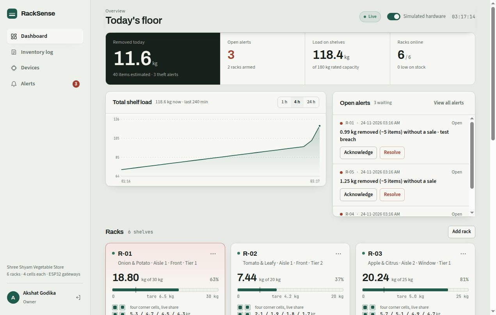
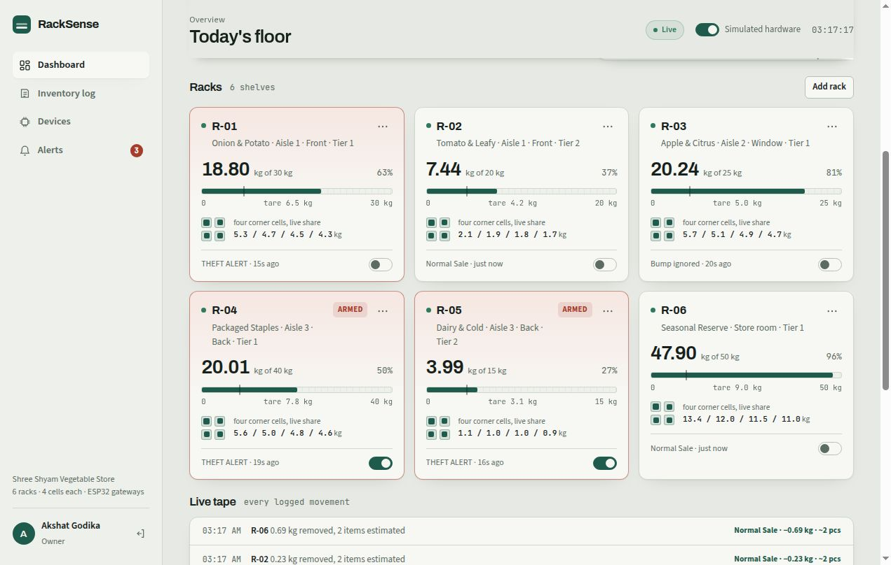

# RackSense

A working web application for the **Smart Weight-Sensing Retail Rack System** project: under-rack
load cells report stock weight continuously, and RackSense turns every settled drop into a sale, a
restock or a theft alert on a live shop dashboard, with the alert log exported to Excel.

This is the software half of the project — the ESP32 firmware contract is included, and a
simulator stands in for real hardware so the whole flow can be demonstrated without the rack.

## Run it

```bash
pip install -r requirements.txt
python3 -m uvicorn main:app --host 0.0.0.0 --port 8060
```



Open http://localhost:8060 and press **Enter the demo shop**, or sign in:

| user    | password    | can                                                              |
| ------- | ----------- | ---------------------------------------------------------------- |
| `owner` | `rack1234`  | everything: add/remove racks, arm, tare, resolve alerts, exports  |
| `staff` | `staff1234` | watch, tare, acknowledge/resolve, arm or disarm                   |

Environment: `RACKSENSE_DB` (sqlite path), `RACKSENSE_SIM_SECONDS` (default 7),
`RACKSENSE_TZ` (default `Asia/Kolkata`), `RACKSENSE_DEMO=0` to remove the demo button.

## Deploy on Render

The repository ships a Render blueprint (`render.yaml`): one free Python web service, health check
on `/api/health`, auto-deploy on every push to `main`.

1. Render Dashboard → **New → Blueprint**, pick this repository, **Apply**.
2. The service builds with `pip install -r requirements.txt` and starts with
   `uvicorn main:app --host 0.0.0.0 --port $PORT`.
3. Open the service URL and press **Enter the demo shop**.

The free plan has an ephemeral filesystem and sleeps after 15 minutes idle (the first request takes
about a minute to wake). The SQLite database therefore reseeds on every deploy or restart — fine for
a demo, not for real stock history. For persistence, add a Render disk and set
`RACKSENSE_DB=/var/data/racksense.db`, or move `database.py` to Postgres.

## How the measurement works

The server implements the algorithm from the project deck in `engine.py`:

1. **Tare & baseline** — the last stable rack load is the reference weight (per rack, stored).
2. **Stabilise delay** — a reading counts only when three consecutive samples agree within 90 g, so
   a hand on the shelf or a crate being nudged does not register; the excursion is logged as
   *Bump ignored*.
3. **Weight delta** — previous stable weight minus current stable weight; anything under 120 g is
   scale drift, not stock movement.
4. **Item estimate** — removed grams ÷ the rack's average item weight (per rack, editable).
5. **Breach alert** — a removal on an armed rack writes a `THEFT ALERT` event and an alert, queues a
   `buzz` command for that rack's controller, and pushes the alert to every open dashboard over a
   WebSocket in the same second.

Restocks, tare events and low-stock crossings (below the rack's threshold) are logged separately.

## API

| method | path | who | what |
| --- | --- | --- | --- |
| POST | `/api/auth/login` | — | username/password → session token |
| POST | `/api/auth/demo` | — | one-click demo session (owner) |
| GET | `/api/snapshot` | user | racks, last events, open alerts, KPIs |
| GET/POST | `/api/racks` | user / owner | list and create racks |
| PATCH/DELETE | `/api/racks/{id}` | user / owner | edit (arm/disarm for any user), remove |
| POST | `/api/racks/{id}/tare` | user | save the current load as baseline |
| POST | `/api/racks/{id}/simulate` | user | sale / theft / restock / bump / empty |
| GET | `/api/events`, `/api/series` | user | log with filters, load history |
| GET/POST | `/api/alerts`, `/api/alerts/{id}/ack`, `/resolve` | user | alert list and handling |
| GET | `/api/export.xlsx`, `/api/export.csv` | user | the inventory log as a file |
| POST | `/api/device/telemetry` | device key | one load-cell sample, answers `buzz` |
| GET | `/api/device/{key}/config`, `/commands` | device key | firmware config, queued commands |
| WS | `/ws?token=` | user | live snapshot stream |

Interactive reference at `/api/docs`.

## Hardware contract

`static/firmware/racksense_esp32.ino` is a complete sketch: HX711 on 4 paralleled 50 kg cells, a
median-of-5 window, a report every 500 ms, a 3 s command poll for the buzzer/tare queue, and a
hardware tare posted at boot. Each rack has its own device key, shown on the **Devices** tab.

## Screenshots

| | |
| --- | --- |
|  | Live tape of every logged movement |

## Layout

```
main.py          FastAPI routes, auth, exports, WebSocket, simulator
engine.py        tare/stabilise/delta/quantity/breach logic
database.py      sqlite schema and demo seed
security.py      PBKDF2 passwords, session tokens
static/          dashboard (no build step), firmware sketch
data/            sqlite database (created on first run)
```

## What it is not

Single-shop, single-process deployment: SQLite and an in-process WebSocket hub. For a chain of
shops you would move the database to Postgres and the live feed to a broker, and the device keys
would be rotated per gateway. Item counts remain estimates from average item weight — the deck's
stated limitation — until per-crate RFID or barcode confirmation is added.
